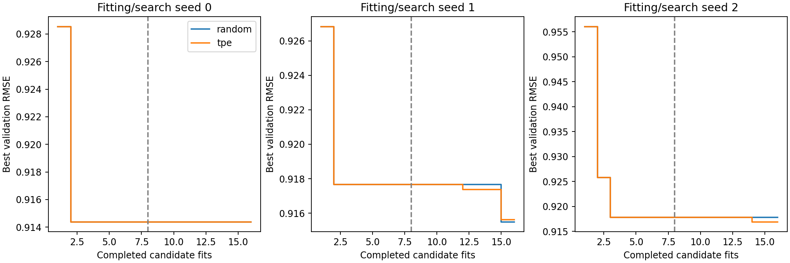

# Adaptive model search on MovieLens

Sequential Optuna TPE and random search optimize the same degree-regularized biased factor model using Adam. All 96 candidate fits complete 40 epochs; each strategy gets 16 candidates per seed. The first eight parameter proposals match exactly. Subsequent TPE proposals use validation outcomes; random proposals do not. Rank, factor/bias penalties and learning rate vary. Candidate budgets and model compute are explicit, not equal FLOPs.

Fit/validation/test are 64,000/16,000/20,000 official MovieLens-100K ratings, preserving the earlier fixed split. The official test is scored only after a strategy selects its best validation candidate and epoch. This compares search procedures with a shared model family; it does not compare recommender architectures or measure chronological user behavior.

| Search | Test RMSE mean ± fit SD | Validation RMSE |
|---|---:|---:|
| random | 0.93691 ± 0.00098 | 0.91588 |
| tpe | 0.93781 ± 0.00182 | 0.91563 |



Three-seed variation combines changes in factor initialization, batch order and proposal seed. Curves are validation measurements; the table contains the one selected model per campaign. Limited trials and split reuse can make selection optimistic. Neither a Bayesian-search label nor a modern library guarantees improvement. Partial searches reject continuation to avoid inventing sampler-RNG reproducibility; complete records skip unchanged. Use a fresh `--output` for a new campaign.

```bash
python scripts/run_adaptive_search.py --seed 0 --strategy tpe --device cuda:0
python scripts/report_extensions.py
```

See [selected fits](adaptive_search_fits.csv), [validation](extensions_validation.json), [the original factor objective](../src/optimization_lab/recommendation.py), and [Optuna TPE documentation](https://optuna.readthedocs.io/en/stable/reference/samplers/generated/optuna.samplers.TPESampler.html). MovieLens ratings and factor checkpoints remain private.
