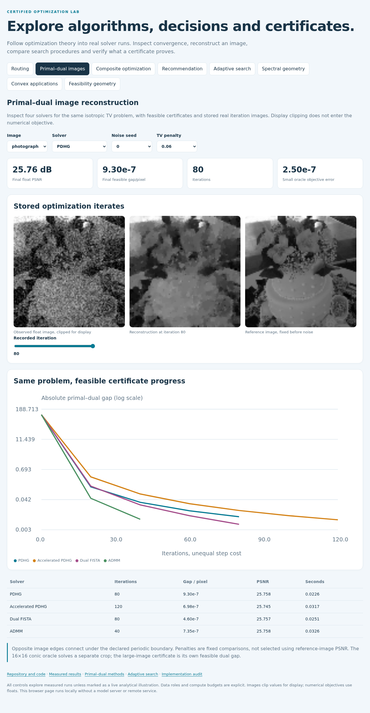

# Explore optimization locally

Open [explorer.html](explorer.html) after cloning or downloading this repository.
Double-clicking works; the page uses embedded measurements and local PNG files,
without a Python service, model download or remote API.



| Concept | Controls | What is actually calculated or measured |
|---|---|---|
| Routing | Instance, method, seed, recorded incumbent index | All 84 cyclic integer-distance tours, independently certified lower bounds and saved objective traces |
| Primal–dual images | Photograph/procedural image, solver, seed, penalty, stored iterate | 72 real solver runs, actual saved iteration images, feasible dual gaps and independent crop oracles |
| Composite optimization | Lasso/nuclear problem, seed, quadratic conditioning | Recorded objective and feasible-gap curves; retained budget failures and unequal curvature access |
| Recommendation | Original/search protocol, method, seed, candidate | All 81 earlier candidates; inspected candidate curves separated from the deployed winner's test result |
| Adaptive search | Fitting/search seed, strategy, trial | All 96 random/TPE fits, shared startup proposals, validation trajectories and the six selected test outcomes |
| Spectral geometry | SVD rank, PCA scaling | Raw optimal-approximation identity versus clipped display quality, descriptive Iris geometry and QR residuals |
| Convex applications | Seven models | Saved speed, resource, blending, PSD, control, evacuation and risk solutions with stated numerical evidence |
| Feasibility geometry | Domain, point coordinates, square-root slice | Live evaluation of the four stated inequalities, compared against Python; separate recorded cone-solver witnesses |

The route map shows the final saved tour. Moving the trace cursor changes its
reported historical incumbent length; it does not invent missing intermediate
tours. TV iteration controls use actual saved snapshots. The last snapshot is the
certified final solution, while early images are intermediate iterates. Photograph
and source arrays retain their separate [CC BY credit](third_party.md).

The feasibility panel is a small live analytical illustration. Its shaded domain
is a rasterized slice and its inequalities are evaluated directly. A recorded
three-dimensional witness can belong to a different slice; the panel explains that
rather than representing it as a new solved program.

## Local HTTP preview and GitHub

From the repository root:

```bash
python -m http.server 8000
```

Visit `http://localhost:8000/docs/explorer.html`. This server is optional for the
local file version. GitHub's README displays the screenshots but does not run HTML
as an application. After publishing, enable Pages manually with **Settings → Pages
→ Deploy from a branch → main → /(root)**. The demo address then has the form
`https://YOUR_USERNAME.github.io/YOUR_REPOSITORY/docs/explorer.html`; add the actual
address after hosting finishes. No automatic publication occurs here.

## Rebuild and audit

```bash
python scripts/report_extensions.py
python scripts/create_explorer.py
python -m pip install playwright==1.63.0
python -m playwright install chromium
python scripts/check_explorer_browser.py
python scripts/validate_explorer.py
```

Keep the browser cache outside Git, optionally through `PLAYWRIGHT_BROWSERS_PATH`.
The generator requires all 55 full protocols. Source hashes bind the HTML templates,
generator, measurements and numeric arrays. The independent validator compares each
published image against its float source and every interactive prediction/search
row with the recorded result. Chromium checks all eight sections, every measured
preset, boundary examples for the live inequalities and 390px mobile layouts.
Read [browser evidence](explorer_browser_validation.json), [numeric evidence](explorer_validation.json)
and [the manifest](explorer_manifest.json).

The wheel carries reusable methods, default configs and the licensed example photo.
Use the repository or source archive for reports, notebooks, templates and the demo.

See the [user interaction audit](demo_review.md) for the HTTP selector, slider,
asset and numerical verification commands and their precise scope.
