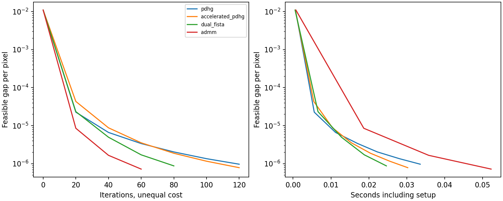
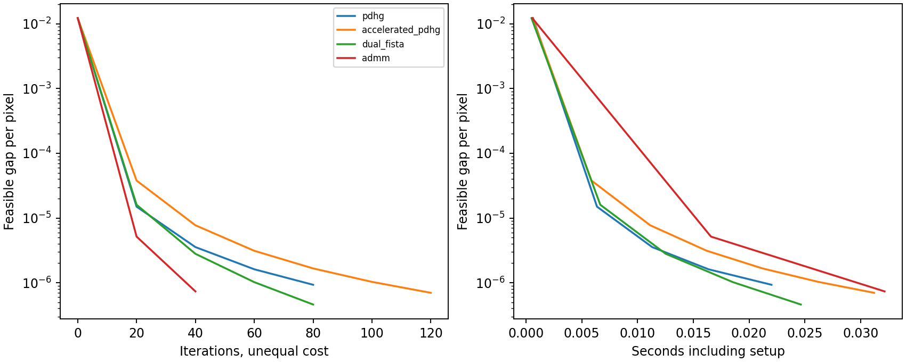

# Primal–dual image reconstruction

Minimize `0.5 ||x-b||² + λ Σpixel ||Dx||₂` with periodic forward differences. PDHG, strongly-convex accelerated PDHG, projected dual FISTA and FFT ADMM solve the same unconstrained float-image objective. A projected dual field gives a feasible Fenchel lower bound independently of solver. We stop at a gap per pixel of 1e-6, rather than comparing arbitrary iteration counts.

All 72 solves cover three noise seeds, two images and three fixed penalties. The procedural image is identified separately from the attributed photograph. Penalties are diagnostic controls, not selected by test PSNR. Displays clip pixels; fidelity, certificates and PSNR use original floats. Periodic boundaries connect opposite edges and can cause wraparound artifacts.

| Image | Penalty | Method | PSNR mean ± fit SD | Mean iterations | Mean seconds |
|---|---:|---|---:|---:|---:|
| photograph | 0.02 | accelerated_pdhg | 22.592 ± 0.027 | 60.0 | 0.0154 |
| photograph | 0.02 | admm | 22.640 ± 0.026 | 20.0 | 0.0169 |
| photograph | 0.02 | dual_fista | 22.694 ± 0.027 | 20.0 | 0.0068 |
| photograph | 0.02 | pdhg | 22.688 ± 0.027 | 20.0 | 0.0068 |
| photograph | 0.06 | accelerated_pdhg | 25.772 ± 0.073 | 106.7 | 0.0277 |
| photograph | 0.06 | admm | 25.790 ± 0.077 | 40.0 | 0.0310 |
| photograph | 0.06 | dual_fista | 25.790 ± 0.077 | 80.0 | 0.0237 |
| photograph | 0.06 | pdhg | 25.790 ± 0.077 | 86.7 | 0.0221 |
| photograph | 0.15 | accelerated_pdhg | 23.828 ± 0.110 | 173.3 | 0.0478 |
| photograph | 0.15 | admm | 23.774 ± 0.110 | 286.7 | 0.2200 |
| photograph | 0.15 | dual_fista | 23.774 ± 0.110 | 246.7 | 0.0736 |
| photograph | 0.15 | pdhg | 23.774 ± 0.111 | 753.3 | 0.1888 |
| piecewise | 0.02 | accelerated_pdhg | 23.107 ± 0.027 | 60.0 | 0.0174 |
| piecewise | 0.02 | admm | 23.176 ± 0.026 | 20.0 | 0.0196 |
| piecewise | 0.02 | dual_fista | 23.250 ± 0.027 | 20.0 | 0.0076 |
| piecewise | 0.02 | pdhg | 23.241 ± 0.027 | 20.0 | 0.0066 |
| piecewise | 0.06 | accelerated_pdhg | 30.774 ± 0.054 | 120.0 | 0.0304 |
| piecewise | 0.06 | admm | 31.032 ± 0.055 | 60.0 | 0.0527 |
| piecewise | 0.06 | dual_fista | 31.033 ± 0.055 | 80.0 | 0.0254 |
| piecewise | 0.06 | pdhg | 31.032 ± 0.055 | 133.3 | 0.0346 |
| piecewise | 0.15 | accelerated_pdhg | 35.417 ± 0.131 | 300.0 | 0.0747 |
| piecewise | 0.15 | admm | 35.448 ± 0.139 | 953.3 | 0.7666 |
| piecewise | 0.15 | dual_fista | 35.452 ± 0.140 | 400.0 | 0.1207 |
| piecewise | 0.15 | pdhg | 35.448 ± 0.139 | 2646.7 | 0.6472 |

Every method also solves a separate 16×16 periodic crop, checked against an independent CLARABEL cone model. The crop oracle does not certify the larger image; the feasible dual gap does. Strong convexity makes the image optimum unique, but finite stopping tolerance permits small output differences. Accelerated methods need not win in a finite problem and tolerance regime.

See [all fits](primal_dual_fits.csv), [the source](../src/optimization_lab/primal_dual.py), [validation](extensions_validation.json), and [the interactive explorer](explorer.html). Photo credit and dataset terms are in [third-party attribution](third_party.md).

Primary algorithm reference: [Chambolle and Pock](https://www.cmap.polytechnique.fr/preprint/repository/685.pdf).
