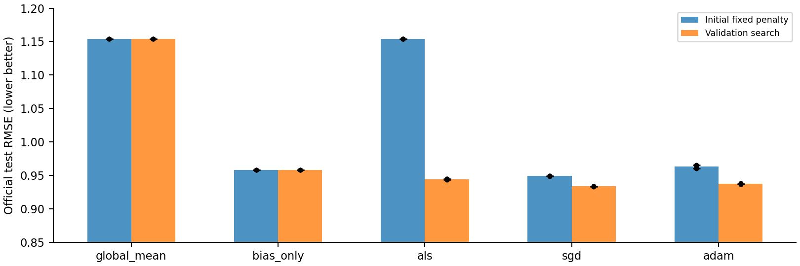
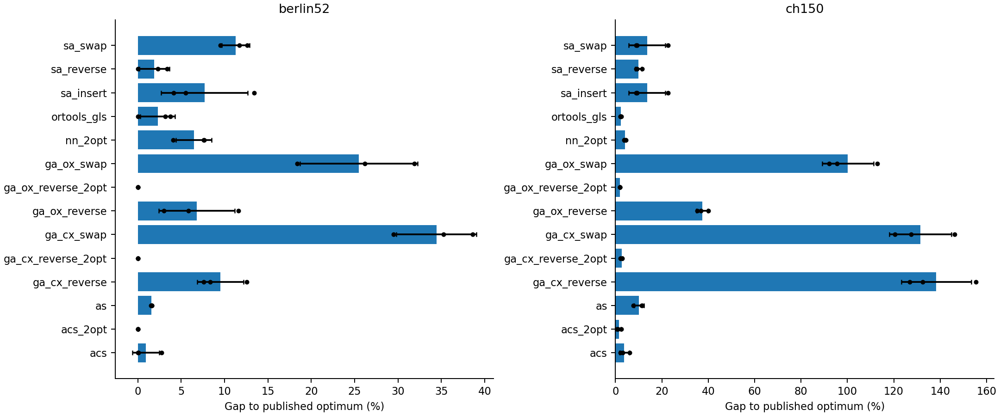

# Measured results

The release contains 55 complete protocols. Figures below are regenerated from included numeric evidence.

## MovieLens official test

Means and sample SD across three fitting seeds; repeated deterministic baselines have zero fitting variability. User-bootstrap intervals are separately retained in each model record.

| Method | Test RMSE, mean ± fit SD | Test MAE | Worst fitted-seed RMSE |
|---|---:|---:|---:|
| global_mean | 1.15367 ± 0.00000 | 0.96800 | 1.15367 |
| bias_only | 0.95816 ± 0.00000 | 0.75484 | 0.95816 |
| als | 0.94449 ± 0.00077 | 0.74053 | 0.94507 |
| sgd | 0.93370 ± 0.00043 | 0.73337 | 0.93404 |
| adam | 0.93733 ± 0.00057 | 0.74022 | 0.93797 |

The initial penalty 0.01 ALS fit overfits: monotone training loss does not imply good validation. Its epoch0 selection and poor test score remain public. The extension selects regularization and stochastic learning rates using validation, with every candidate recorded. Matched-penalty curves avoid comparing differently regularized objective values.

## Routing

| Instance | Method | Mean length ± across-run SD | Best / worst length | Mean optimum gap (%) |
|---|---|---:|---:|---:|
| berlin52 | acs | 7612.3 ± 117.5 | 7542 / 7748 | 0.933 |
| berlin52 | acs_2opt | 7542.0 ± 0.0 | 7542 / 7542 | 0.000 |
| berlin52 | as | 7661.0 ± 3.5 | 7657 / 7663 | 1.578 |
| berlin52 | ga_cx_reverse | 8259.3 ± 202.6 | 8115 / 8491 | 9.511 |
| berlin52 | ga_cx_reverse_2opt | 7542.0 ± 0.0 | 7542 / 7542 | 0.000 |
| berlin52 | ga_cx_swap | 10139.7 ± 348.1 | 9765 / 10453 | 34.443 |
| berlin52 | ga_ox_reverse | 8055.0 ± 330.3 | 7768 / 8416 | 6.802 |
| berlin52 | ga_ox_reverse_2opt | 7542.0 ± 0.0 | 7542 / 7542 | 0.000 |
| berlin52 | ga_ox_swap | 9464.7 ± 511.5 | 8929 / 9948 | 25.493 |
| berlin52 | nn_2opt | 8028.3 ± 155.3 | 7849 / 8120 | 6.448 |
| berlin52 | ortools_gls | 7715.3 ± 151.6 | 7542 / 7823 | 2.298 |
| berlin52 | sa_insert | 8121.7 ± 376.2 | 7855 / 8552 | 7.686 |
| berlin52 | sa_reverse | 7685.3 ± 130.4 | 7542 / 7797 | 1.900 |
| berlin52 | sa_swap | 8393.7 ± 120.1 | 8261 / 8495 | 11.292 |
| ch150 | acs | 6775.0 ± 135.1 | 6663 / 6925 | 3.784 |
| ch150 | acs_2opt | 6621.3 ± 58.3 | 6580 / 6688 | 1.430 |
| ch150 | as | 7193.0 ± 140.4 | 7031 / 7279 | 10.187 |
| ch150 | ga_cx_reverse | 15557.0 ± 985.2 | 14816 / 16675 | 138.312 |
| ch150 | ga_cx_reverse_2opt | 6699.7 ± 28.2 | 6668 / 6722 | 2.630 |
| ch150 | ga_cx_swap | 15106.7 ± 870.5 | 14397 / 16078 | 131.413 |
| ch150 | ga_ox_reverse | 8970.7 ± 162.1 | 8828 / 9147 | 37.418 |
| ch150 | ga_ox_reverse_2opt | 6653.3 ± 2.1 | 6651 / 6655 | 1.920 |
| ch150 | ga_ox_swap | 13068.3 ± 724.6 | 12548 / 13896 | 100.189 |
| ch150 | nn_2opt | 6794.3 ± 31.1 | 6765 / 6827 | 4.080 |
| ch150 | ortools_gls | 6675.7 ± 12.9 | 6665 / 6690 | 2.262 |
| ch150 | sa_insert | 7416.7 ± 512.2 | 7113 / 8008 | 13.613 |
| ch150 | sa_reverse | 7172.0 ± 88.7 | 7113 / 7274 | 9.865 |
| ch150 | sa_swap | 7416.7 ± 512.2 | 7113 / 8008 | 13.613 |

OR-Tools uses a separately disclosed 5 s time limit; owned methods use a 10M distance-edge-work cap. These are not equal-FLOP budgets. Fixed-seed route figures avoid selecting the best-looking fit. Main textbook variants and separately named local-search hybrids are all included.

## Numerical checks

Lasso feasible dual gaps reach1e-7 and nuclear completion1e-6 on all three synthetic problems. Poisson projected KKT residuals reach1e-7, with the conic objective agreeing within numerical tolerance. The repeated / indefinite / ill-conditioned symmetric QR cases converge with small residuals and retain multiplicity.

The speed reference objective is 2617.825193571; the owned barrier's refined feasible dual gap is 3.41e-08. Control, evacuation and robust-risk checks are stored with their own physical / dual residuals. Held–Karp and MTZ MILP agree at length2248 on the 12-city subproblem; an exact integer1-tree bound matches that value.

These are finite numerical reference checks, not broad superiority, production-deployment or universally certified heuristic-optimality claims. See [protocol](protocol.md), [model cards](model_cards.md), [validation](validation.json) and the individual CSV tables.
